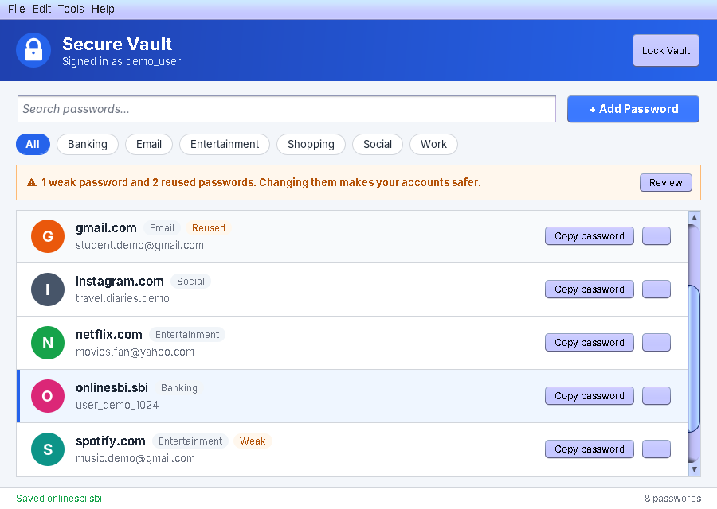
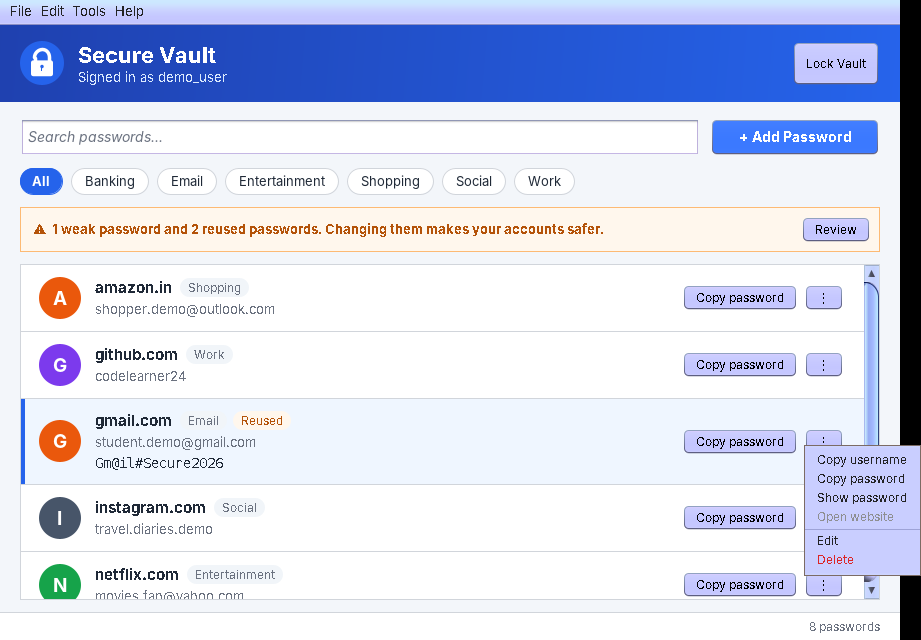
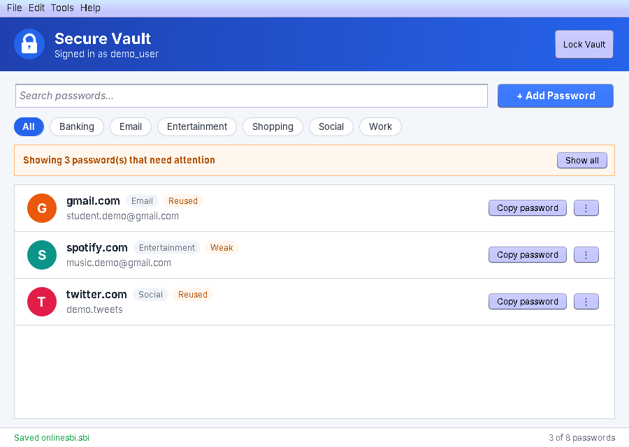
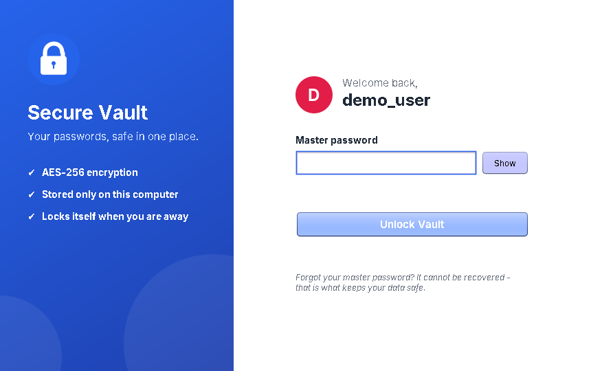
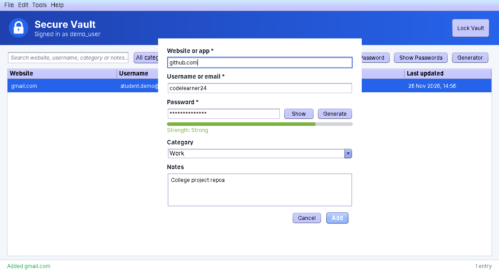
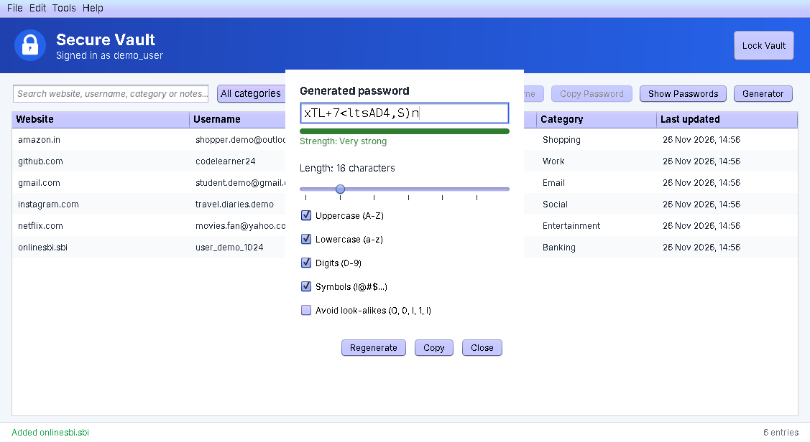
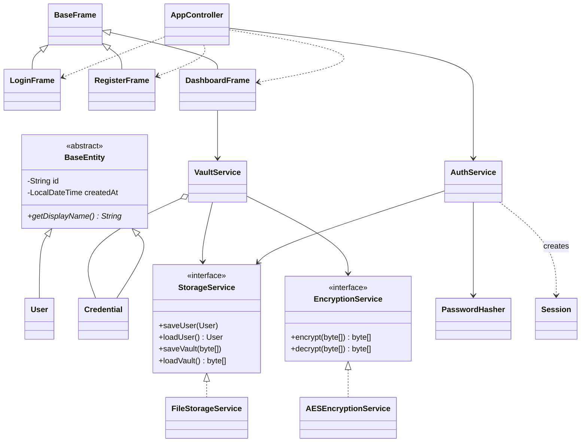

# Secure Vault

A desktop **password manager** built with **Java Swing**, designed around
object-oriented programming principles. All saved passwords are encrypted
with **AES-256** using a key derived from a single master password.



## Features

- **Master account**: register once, then unlock with your master password
- **Lock-out protection**: 3 wrong attempts block login for 30 seconds
- **Clean dashboard**: every password is a card with a coloured site icon and a one-click **Copy password** button
- **Category chips**: filter with one click (All, Email, Social, Banking, ...)
- **Security check**: a banner tells you about weak or reused passwords; **Review** shows just those
- **Manage credentials**: add, edit, delete, search, show a password, open the website
- **Password generator**: choose length and character types, avoid look-alike characters
- **Strength meter**: live feedback while typing a password
- **Warnings** for very weak or reused passwords
- **Copy to clipboard**: the clipboard is cleared automatically after 15 seconds
- **Auto-lock**: the vault locks after 5 minutes without activity
- **Change master password**: the whole vault is re-encrypted with the new key
- **Automatic backup**: a damaged vault file is restored from the last good copy
- **Keyboard shortcuts**, arrow-key navigation, right-click menu and double-click to edit

| Card menu | Security review |
|---|---|
|  |  |

| Login | Add entry | Password generator |
|---|---|---|
|  |  |  |

## Running the app

You need **Java 11 or newer** (JDK). Check with `java -version`.

### Option 1: build with the script (no Maven needed)

Windows:
```bat
build.bat
run.bat
```

Linux / macOS / Git Bash:
```bash
./build.sh
java -jar secure-vault.jar
```

### Option 2: build with Maven

```bash
mvn package
java -jar target/secure-vault.jar
```

### Option 3: from an IDE

Open the folder in IntelliJ IDEA, Eclipse or NetBeans as a Maven project and run
`com.securevault.Main`.

## Using the app

1. On first start, create your master account (username + strong master password).
2. Click **+ Add Password** to save a login. Use **Generate** for a strong random password.
3. Click **Copy password** on a card to paste it into a website. The clipboard clears itself after 15 seconds.
4. Use the **⋮** button on a card to copy the username, show the password, open the website, edit or delete.
5. Type in the search box or click a category chip to filter the list.
6. If the orange banner appears, click **Review** to see weak or reused passwords and change them.
7. Click **Lock Vault** (or press `Ctrl+L`) when you step away.

> **The master password cannot be recovered.** Without it, the vault cannot be decrypted.

### Keyboard shortcuts

| Shortcut | Action |
|---|---|
| `Ctrl+N` | Add entry |
| `Ctrl+E` / `Enter` | Edit selected entry |
| `Delete` | Delete selected entry |
| `Ctrl+B` | Copy username |
| `Ctrl+C` (in list) / `Ctrl+Shift+C` | Copy password |
| `Ctrl+F` | Search |
| `Esc` (in search) | Clear search |
| `↓` (in search), `↑` / `↓` (in list) | Move through the list |
| `Ctrl+G` | Password generator |
| `Ctrl+L` | Lock vault |
| `Ctrl+Q` | Exit |
| `F1` | About |

## Where data is stored

Everything is kept in the `.securevault` folder in your home directory:

| File | Contents |
|---|---|
| `user.properties` | username, password **hash** and salts (never the password) |
| `vault.dat` | all credentials, encrypted with AES-256-GCM |
| `vault.dat.bak` | previous copy of the vault, used for recovery |
| `securevault.log` | error log (never contains passwords) |

To start over, close the app and delete this folder.

## Security design

| Concern | How it is handled |
|---|---|
| Storing the master password | Only a PBKDF2-HMAC-SHA256 hash (210,000 iterations, random 16-byte salt) is saved |
| Encryption key | Derived from the master password with PBKDF2 and a separate salt; it only exists in memory while unlocked |
| Vault encryption | AES-256 in GCM mode with a fresh random IV on every save; tampering is detected |
| Brute force | Slow key derivation plus a lock-out after 3 failed attempts |
| Leftover secrets | Password arrays are wiped after use, the clipboard is cleared, the vault auto-locks |
| Crashes while saving | Files are written to a temporary file and moved into place atomically |

## OOP concepts used

| Concept | Where |
|---|---|
| **Encapsulation** | Private fields with validating setters in `Credential` and `User` |
| **Abstraction** | `EncryptionService` and `StorageService` interfaces hide *how* encryption and storage work |
| **Inheritance** | `Credential`/`User` extend `BaseEntity`; frames extend `BaseFrame`; dialogs extend `BaseDialog`; exceptions extend `VaultException` |
| **Polymorphism** | `AESEncryptionService` and `FileStorageService` are used through their interfaces; `getDisplayName()` is overridden; one `Action` drives a button, a menu item and a shortcut |
| **Composition** | `VaultService` *has a* `StorageService` and an `EncryptionService` |
| **Custom components** | `CredentialCard`, `SiteAvatar`, `FilterChip`, `Tag`, `SecurityBanner`, `PasswordStrengthBar`, `PasswordInput`, `SearchField`, `HeaderPanel` |
| **Interfaces for callbacks** | `CredentialCard.Listener` lets a card tell the dashboard what happened without knowing about it |

### Class overview



## Project structure

```
src/main/java/com/securevault/
 ├── Main.java                 entry point
 ├── config/AppConfig          all settings in one place
 ├── model/                    BaseEntity, User, Credential, PasswordStrength
 ├── exception/                VaultException and its subclasses
 ├── security/                 PasswordHasher, AESEncryptionService,
 │                             PasswordGenerator, PasswordStrengthChecker
 ├── storage/                  StorageService, FileStorageService, CredentialSerializer
 ├── service/                  AuthService, VaultService, Session,
 │                             SecurityAnalyzer, SecurityReport
 ├── util/                     ClipboardManager, InputValidator, AppLogger
 └── ui/                       AppController, frames, dialogs, components
src/test/java/                 JUnit 5 tests
```

## Tests

```bash
mvn test
```

103 JUnit tests cover the models, hashing, encryption, the password generator,
file storage, login and lock-out, vault operations, backup recovery and the security check.

## Development branches

| Branch | Purpose |
|---|---|
| `project-setup` | Folder structure, Maven build, configuration |
| `data-models` | `BaseEntity`, `User`, `Credential`, `PasswordStrength` |
| `core-architecture` | Encryption/storage interfaces and exception hierarchy |
| `security-encryption` | Hashing, AES encryption, generator, strength checker |
| `data-storage` | Encrypted file storage |
| `vault-service` | Authentication and credential management logic |
| `swing-user-interface` | Login, registration, dashboard and dialogs |
| `event-handling` | Shortcuts, context menu, clipboard clearing, auto-lock |
| `error-handling-validation` | Friendly errors, logging, input checks, backup recovery |
| `unit-tests` | JUnit test suite |
| `packaging-release` | Build scripts, runnable JAR, documentation |
| `dashboard` | Card-based dashboard, category chips, security check banner |
